# 📸 Awesome Photo Management

  

  
  
  
  
  
  
  

---

## 🌟 Curated Directory of Self-Hosted Archives, Cloud Storage & AI-Powered Photo Ecosystems

> An SEO-optimized, definitive guide to the modern **Photo Management Ecosystem**. Whether you are looking for **privacy-first self-hosted alternatives to Google Photos**, professional **RAW photography workflows**, zero-knowledge encrypted cloud backups, or lightweight Raspberry Pi galleries, this curated collection covers leading **SaaS platforms** and **open-source GitHub repositories**.

---

## 📑 Table of Contents

- [📊 Sector Overview & Market Dynamics](#-sector-overview--market-dynamics)
- [☁️ Top SaaS & Hosted Photo Management Platforms](#️-top-saas--hosted-photo-management-platforms)
- [🏠 Top Open-Source Self-Hosted Photo Managers](#-top-open-source-self-hosted-photo-managers)
- [🧩 Quick Feature Comparison Matrix](#-quick-feature-comparison-matrix)
- [🧭 Architectural Decision Guide: How to Choose](#-architectural-decision-guide-how-to-choose)
- [🤝 How to Contribute](#-how-to-contribute)
- [⭐ Star History](#-star-history)
- [💖 Support & Sponsoring](#-support--sponsoring)
- [⚖️ Disclaimer](#️-disclaimer)

---

## 📊 Sector Overview & Market Dynamics

The digital photo management and cloud storage ecosystem is undergoing rapid transformation driven by exponential image creation, advancements in local neural networks, and heightened consumer privacy awareness:

- **📈 Market Size & Forecast**: The global digital photo management and cloud backup software market is valued at approximately **$23.8 Billion in 2025** and is projected to expand to **$41.5 Billion by 2032**, registering a robust compound annual growth rate (**CAGR of ~8.2%**).
- **🏛️ Market Concentration & Fragmentation**:
  - **Consumer Cloud Tier (Highly Concentrated / Winner-Take-All)**: The general consumer market is dominated by mobile OS gatekeepers (**Apple** and **Google/Alphabet**), which jointly capture over **75%** of default mobile camera backups through OS bundling, AI computational photography, and unified subscription ecosystems (Apple One, Google One).
  - **Prosumer & Self-Hosted Tier (Moderately Fragmented & Rapidly Innovating)**: In contrast, the enthusiast, archival, and self-hosted sectors are intensely competitive and fragmented. Spurred by cloud subscription cost fatigue, algorithmic surveillance concerns, and sudden cloud vendor lock-ins, self-hosted platforms like **Immich**, **PhotoPrism**, and zero-knowledge solutions like **Ente** have exploded in adoption. Local multimodal models (SigLIP, CLIP, face clustering) now enable consumer-grade home servers to match or exceed commercial AI search capabilities without compromising user privacy.

---

## ☁️ Top SaaS & Hosted Photo Management Platforms

Below is an overview of major hosted SaaS photo management platforms, sorted in descending order by **parent company valuation and annual revenue**.

| 🌐 Platform | 🏢 Company & Valuation / Revenue | 💰 Starting Pricing Tier | 🆓 Free Tier Limit & Trial Period | 🎯 Key Capabilities & Ecosystem Focus |
| :--- | :--- | :--- | :--- | :--- |
| **[Apple Photos (iCloud+)](https://www.icloud.com/photos)** | **Apple Inc.** • Market Cap: **~$3.5 Trillion** • Annual Revenue: **~$391 Billion** | **$0.99 / month** *(iCloud+ 50 GB plan)* | **5 GB free forever** storage across all Apple devices per Apple ID account | 📱 Native OS integration across iOS, iPadOS, and macOS. Zero-setup background sync, Shared Photo Libraries, on-device Neural Engine face & pet grouping. Strong ecosystem lock-in. |
| **[Google Photos (Google One)](https://photos.google.com/)** | **Alphabet Inc. (Google)** • Market Cap: **~$2.2 Trillion** • Annual Revenue: **~$350 Billion** | **$1.99 / month** *(Google One 100 GB Basic)* | **15 GB free forever** storage shared across Google Photos, Google Drive, and Gmail | 🔍 Industry gold standard for semantic natural language search ("dog on the beach 2022"), Magic Editor, automated partner sharing, cross-platform Android and iOS auto-upload. |
| **[Amazon Photos](https://www.amazon.com/photos)** | **Amazon.com, Inc.** • Market Cap: **~$2.1 Trillion** • Annual Revenue: **~$620 Billion** | **$14.99 / month or $139 / year** *(Included with Amazon Prime; standalone 100 GB from $1.99/mo)* | **5 GB free forever** full-resolution photo and video storage for all non-Prime Amazon accounts | 📦 **Unlimited full-resolution photo storage** (including RAW formats) for Prime members. 5 GB video limit. Digital photo frame ambient display on Echo Show and Fire TV devices. |
| **[Adobe Lightroom Cloud](https://lightroom.adobe.com/)** | **Adobe Inc.** • Market Cap: **~$210 Billion** • Annual Revenue: **~$21.5 Billion** | **$9.99 / month** *(Lightroom Plan with 1 TB dedicated cloud storage)* | **7-day free trial** with full 1 TB cloud storage and complete professional RAW editing suite | 🎨 Professional photography editing pipeline with non-destructive adjustments, camera color profiles, Adobe Sensei visual search, multi-device cloud synchronization, and client web galleries. |
| **[Dropbox Photos & Backup](https://www.dropbox.com/)** | **Dropbox, Inc.** • Market Cap: **~$8.5 Billion** • Annual Revenue: **~$2.5 Billion** | **$9.99 / month** *(Dropbox Plus 2 TB, billed annually at $119.88/yr)* | **2 GB free forever** cloud storage across up to 3 connected devices *(or 30-day free trial for Plus)* | 🔄 Fast multi-platform desktop/mobile camera roll sync, delta-sync technology, LAN synchronization, 30-day file version history, and frictionless link sharing. |
| **[SmugMug & Flickr Pro](https://www.flickr.com/)** | **SmugMug, Inc.** • Valuation: **~$400 Million** (Private) • Annual Revenue: **~$100M+** | **$8.25 / month** *($71.99/year billed annually for Flickr Pro; SmugMug from $13/mo)* | **1,000 photos/videos free forever** on Flickr; **14-day free trial** with unlimited uploads on SmugMug | 🖼️ Dedicated photo portfolio publishing, print fulfillment labs, EXIF metadata discovery, photographer communities, and unlimited full-resolution archival storage without compression. |
| **[Mylio Photos+](https://www.mylio.com/)** | **Mylio, LLC** • Valuation: **~$15 Million** (Private) • Annual Revenue: **~$10M Est.** | **$9.99 / month or $99 / year** *(Mylio Photos+ multi-device peer sync)* | **Free forever plan** for single-device photo indexing, organizing, and basic editing; **30-day free trial** for Photos+ | 🛡️ Local-first architecture: photographs stay on user devices and sync peer-to-peer over local Wi-Fi without mandatory third-party cloud hosting. Encrypted cloud vault support. |

---

## 🏠 Top Open-Source Self-Hosted Photo Managers

The open-source self-hosted photo ecosystem provides sovereign control, local AI computation, zero subscription fees, and transparent storage formats.

> 💡 **Sorted in descending order by GitHub Star Count**. Click any star badge to inspect stargazers and repository velocity.

---

### 1. 🚀 [Immich](https://github.com/immich-app/immich)

- **Description**: The premier open-source Google Photos replacement. High-performance self-hosted solution featuring polished native iOS and Android apps with background camera upload, multi-user support, shared partner libraries, and interactive timeline scrubbers.
- **AI & Processing**: Local machine learning container running CLIP semantic search, facial recognition, duplicate detection, and reverse geocoding without sending a single byte to external clouds.
- **Stack & Architecture**: NestJS backend, Flutter mobile apps, SvelteKit web client, PostgreSQL with pgvector, and Valkey/Redis cache.
- **License**: AGPL-3.0

---

### 2. 💎 [PhotoPrism](https://github.com/photoprism/photoprism)

- **Description**: Highly mature, AI-powered personal photo manager for decentralized networks. Ideal for existing photo archives, camera RAW files, videos, and complex folder structures.
- **AI & Processing**: TensorFlow-based object categorization, facial recognition, and color extraction. Parses Google Photos JSON sidecar metadata for seamless migration.
- **Stack & Architecture**: Go backend, Vue.js frontend, MariaDB/MySQL storage engine. Lightweight 2-container deployment.
- **License**: AGPL-3.0

---

### 3. 🔐 [Ente](https://github.com/ente-io/ente)

- **Description**: End-to-end encrypted (E2EE) photo backup platform designed as an uncompromised privacy-first cloud or self-hosted service. Encryption keys remain solely on your device; even server operators cannot see your photos or metadata.
- **Features**: Native apps for iOS, Android, macOS, Windows, Linux, and Web. Multi-profile support, family sharing, and automated background sync.
- **Stack & Architecture**: Go server, Flutter mobile applications, WebAssembly cryptographic modules, S3-compatible object storage.
- **License**: AGPL-3.0

---

### 4. 🧠 [LibrePhotos](https://github.com/LibrePhotos/librephotos)

- **Description**: A self-hosted photo management engine with a strong focus on advanced local AI discovery and computer vision pipelines.
- **Features**: SigLIP 2 zero-shot tagging (900+ automatic tags), facial recognition, scene detection, perceptual hash duplicate detection, and photo stacks (unifying RAW+JPEG and Live Photos into a single entity).
- **Stack & Architecture**: Python/Django backend, React frontend, PostgreSQL database.
- **License**: MIT

---

### 5. 🖼️ [Photoview](https://github.com/photoview/photoview)

- **Description**: Simple, user-friendly photo gallery designed specifically for personal servers and home labs. Scans existing file directories without altering file layouts.
- **Features**: EXIF parsing, RAW format decoding, face detection, video streaming, and responsive web gallery with low CPU/RAM consumption.
- **Stack & Architecture**: Go backend, React UI, MariaDB/PostgreSQL/SQLite.
- **License**: AGPL-3.0

---

### 6. 🍃 [Lychee](https://github.com/LycheeOrg/Lychee)

- **Description**: Great-looking, easy-to-use web photo-management server you can deploy on any LAMP/LNMP stack or Docker container to manage and share albums.
- **Features**: Elegant dark/light themes, password-protected albums, public sharing links, multi-user permission controls, full EXIF support, and Dropbox/server import tools.
- **Stack & Architecture**: PHP (Laravel framework), Livewire/Vue, MySQL/MariaDB/PostgreSQL/SQLite.
- **License**: MIT

---

### 7. 🔌 [Piwigo](https://github.com/Piwigo/Piwigo)

- **Description**: Mature, battle-tested open-source photo gallery software for the web, powering galleries from personal collections to institutional archives for over two decades.
- **Features**: Rich ecosystem of 200+ community extensions and themes, batch management tools, granular access rights, visitor statistics, and official mobile apps.
- **Stack & Architecture**: PHP, MySQL/MariaDB.
- **License**: GPL-2.0

---

### 8. ⚡ [Nextcloud Memories](https://github.com/pulsejet/memories)

- **Description**: Modern, GPU-accelerated high-performance photo management suite running as a first-class app inside your Nextcloud instance.
- **Features**: Infinite timeline scroll, on-the-fly hardware-accelerated video transcoding, reverse geocoding map exploration, face recognition, and deep integration with existing Nextcloud users and file shares.
- **Stack & Architecture**: PHP/Vue/Node.js, integrated directly with Nextcloud core.
- **License**: AGPL-3.0

---

### 9. 📱 [Fossify Gallery](https://github.com/FossifyOrg/Gallery)

- **Description**: Privacy-respecting, open-source Android photo and video gallery (the active community continuation of Simple Gallery Pro).
- **Features**: Pure offline local gallery with Material You design, biometric/PIN vault protection, file organizer, built-in image editor, zero ads, zero trackers, and zero network permissions.
- **Stack & Architecture**: Kotlin, Android SDK.
- **License**: GPL-3.0

---

### 10. 🥧 [Pigallery2](https://github.com/bpatrik/pigallery2)

- **Description**: Ultra-fast, directory-first photo gallery website optimized specifically for low-resource hardware like the Raspberry Pi.
- **Features**: Direct read-only folder browsing without forcing library reorganizations, on-the-fly thumbnail generation, search by tags and locations, and facial recognition support.
- **Stack & Architecture**: Node.js/TypeScript backend, Angular frontend, SQLite.
- **License**: MIT

---

### 11. 🔬 [Photonix](https://github.com/photonixapp/photonix)

- **Description**: Modern web-based photo management server engineered with automated AI classification pipelines to organize your visual collection effortlessly.
- **Features**: Object recognition, face detection, location awareness, dominant color analysis, and progressive web application interface.
- **Stack & Architecture**: Python/Django backend, React UI, PyTorch ML models, PostgreSQL database.
- **License**: AGPL-3.0

---

### 12. ⏱️ [Chronoframe](https://github.com/HoshinoSuzumi/chronoframe)

- **Description**: Self-hosted personal gallery web application featuring modern aesthetics, album curation, and comprehensive media support.
- **Features**: Full support for Apple Live Photos and Motion Photos, interactive geolocation map view, timeline curation, and responsive mobile-first UI.
- **Stack & Architecture**: Node.js, TypeScript, modern frontend web components.
- **License**: AGPL-3.0

---

### 13. 🗂️ [Damselfly](https://github.com/Webreaper/Damselfly)

- **Description**: Server-based photograph management application built to index and catalog massive collections of photos (tested with 500,000+ files) with sub-second search times.
- **Features**: IPTC and EXIF keyword tagging, Azure/custom face recognition models, folder synchronization, and fast visual search.
- **Stack & Architecture**: C# / .NET backend, Blazor frontend, SQLite.
- **License**: GPL-3.0

---

### 14. 🏛️ [Tropy](https://github.com/tropy/tropy)

- **Description**: Cross-platform desktop research photo manager purpose-built for historians, researchers, and archivists working with large sets of documentary research photos.
- **Features**: Grouping individual photos into multi-page archival documents, customizable Dublin Core metadata templates, transcription tools, and image annotations.
- **Stack & Architecture**: Electron, JavaScript, SQLite.
- **License**: AGPL-3.0

---

### 15. 🌐 [Thumbsup](https://github.com/thumbsup/thumbsup)

- **Description**: Static HTML photo and video gallery generator. Converts local folders of pictures and videos into a static site that can be hosted on GitHub Pages, Cloudflare Pages, S3, or Nginx.
- **Features**: Generates thumbnails, transcodes videos to web-friendly MP4/HLS, multiple theme choices, zero database requirements, and bulletproof security.
- **Stack & Architecture**: Node.js CLI tool, Handlebars templates.
- **License**: MIT

---

### 16. 💻 [digiKam](https://github.com/KDE/digikam)

- **Description**: Industrial-grade, professional open-source desktop photo management suite developed under the KDE project for Linux, Windows, and macOS.
- **Features**: Full RAW file decoding (LibRaw), comprehensive metadata manipulation (EXIF, IPTC, XMP), lens correction, geolocation editor, batch queue processor, and facial recognition.
- **Stack & Architecture**: C++, Qt framework, SQLite/MySQL/PostgreSQL.
- **License**: GPL-2.0

---

## 🧩 Quick Feature Comparison Matrix

| Project | Stars | Deployment | AI / Faces | Mobile Auto-Upload | RAW Support | Encryption | Ideal For |
| :--- | :--- | :--- | :--- | :--- | :--- | :--- | :--- |
| **Immich** | 116k+ ⭐ | Docker (4 containers) | ✅ (Local CLIP + Face) | ✅ (iOS & Android) | ✅ Yes | In-transit / TLS | Google Photos replacement with phone backup |
| **PhotoPrism** | 40k+ ⭐ | Docker (2 containers) | ✅ (TensorFlow) | ❌ (PWA / WebDAV) | ✅ (Excellent) | In-transit / TLS | Large existing camera archives & metadata search |
| **Ente** | 29k+ ⭐ | Docker / Cloud | ❌ (E2EE focused) | ✅ (iOS & Android) | ✅ Yes | ✅ End-to-End (E2EE) | Zero-knowledge encrypted sovereign cloud |
| **LibrePhotos** | 8.1k+ ⭐ | Docker (4+ containers) | ✅ (SigLIP 2 + Face) | ❌ (PWA) | ✅ (Stacks) | In-transit / TLS | Advanced open-source AI tagging & clustering |
| **Photoview** | 6.5k+ ⭐ | Docker / Binary | ✅ (Basic Face) | ❌ (Web) | ✅ Yes | In-transit / TLS | Lightweight personal server browsing |
| **Lychee** | 4.3k+ ⭐ | Docker / PHP Stack | ❌ No | ❌ (Web) | ⚠️ Partial | In-transit / TLS | Web album sharing & client presentation |
| **Piwigo** | 3.8k+ ⭐ | Docker / PHP Stack | ⚠️ Via plugins | ⚠️ (Community app) | ⚠️ Via plugins | In-transit / TLS | Plugin-heavy web galleries & multi-user teams |
| **Nextcloud Memories**| 3.8k+ ⭐ | Nextcloud App | ✅ (Recognize app) | ✅ (Nextcloud client)| ✅ Yes | Server-side / TLS | Existing Nextcloud infrastructure users |
| **Fossify Gallery** | 3.8k+ ⭐ | Android APK / F-Droid | ❌ No | ❌ Offline only | ✅ Yes | Local App Vault | On-device private mobile photo browsing |
| **Pigallery2** | 2.3k+ ⭐ | Docker / Node.js | ✅ (Face tagging) | ❌ (Web) | ⚠️ Partial | In-transit / TLS | Ultra-low power hardware (Raspberry Pi) |
| **digiKam** | 800+ ⭐ | Desktop (Win/Mac/Linux)| ✅ (Face detection) | ❌ Desktop | ✅ (Camera RAW) | Local disk / LUKS | Professional offline RAW photography catalog |

---

## 🧭 Architectural Decision Guide: How to Choose

When architecting a personal or family photo management stack, evaluate solutions across three core dimensions:

1. **Mobile-First vs. Archive-First**:
   - If your main requirement is replacing **Google Photos** with automatic smartphone background upload and instant timeline browsing, **[Immich](https://github.com/immich-app/immich)** is the recommended open-source standard.
   - If you have an extensive existing photographic archive with years of DSLR/Mirrorless RAW files on a NAS, **[PhotoPrism](https://github.com/photoprism/photoprism)** provides superior metadata indexing, sidecar parsing, and search granularity.
2. **Privacy & Zero-Knowledge Security**:
   - If absolute cryptographic confidentiality is paramount and you do not want server operators or hosting providers to access your photos, **[Ente](https://github.com/ente-io/ente)** provides audited client-side zero-knowledge encryption.
3. **Resource Footprint & Deployment Complexity**:
   - Running on a **Raspberry Pi or modest NAS** (1–2 GB RAM)? Choose **[Pigallery2](https://github.com/bpatrik/pigallery2)** or **[Photoview](https://github.com/photoview/photoview)**.
   - Running modern multicore servers with dedicated GPUs or 8+ GB RAM? Deploy **[Immich](https://github.com/immich-app/immich)** or **[LibrePhotos](https://github.com/LibrePhotos/librephotos)** to take advantage of on-device neural processing.
4. **Hybrid Recommended Architecture**:
   - **Capture & Ingestion**: Immich mobile app with automated camera backup to your home server.
   - **Secondary Archival**: Daily automated rsync/Restic backup of originals to cold storage (e.g., ZFS pool, S3 Glacier, or encrypted external drive).
   - **Desktop Curation**: digiKam connected over NFS/SMB to tag, edit, and organize RAW files directly on disk.

---

## 🤝 How to Contribute

Contributions to expand and refine this ecosystem are welcome!

1. 🍴 **Fork the repository** on GitHub.
2. 📝 **Add or update entries** in `README.md`.
3. 📋 **Ensure accuracy**: Verify exact pricing, free tier terms, GitHub repository stars, and active maintenance status.
4. 🚀 **Submit a Pull Request** with a concise description of your changes.

---

## ⭐ Star History

---

## 💖 Support & Sponsoring

If you found this curated guide helpful, please consider supporting the project:

- ⭐ **Star this repository** to help others in the open-source community find it.
- 🍴 **Fork it** and share your own setup enhancements.
- 📢 **Spread the word** across Reddit, X, Discord, and Mastodon.
- ☕ **Buy a Coffee / Sponsor**: Support continued open-source research and maintenance via the [GitHub Sponsor Dashboard](https://github.com/sponsors/ishandutta2007).

---

## ⚖️ Disclaimer

- This is a community-curated collection intended for educational and architectural reference. Product names, logos, and brands are property of their respective owners.
- Self-hosting shifts operational and data integrity responsibilities to you: always maintain the **3-2-1 backup rule** (3 copies, 2 different media, 1 offsite) for irreplaceable family photos and creative archives. Database backups (PostgreSQL/MariaDB) must be maintained in tandem with media files to preserve albums, faces, and metadata tags.

---

  <b>Built with ❤️ for privacy enthusiasts, photographers, and self-hosters worldwide.</b>

